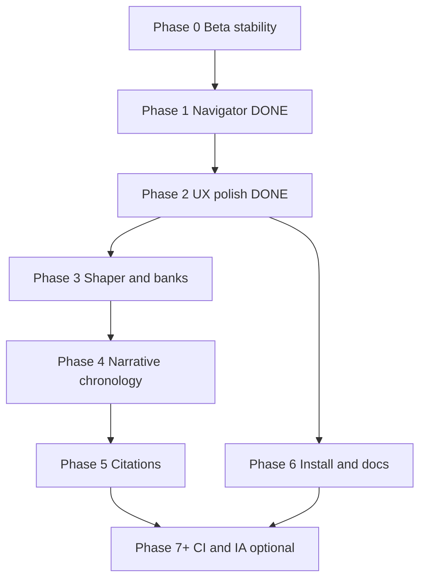

# ProzaEdit Word — Audited Implementation Plan (Primary Roadmap)

**Audience:** D Cracius (author, primary tester, PC + iPad workflows)  
**Authored:** 2026-10-31 (audit + Phase 2 delivery)  
**Supersedes as primary roadmap:** [prozaedit-multi-phase-plan.md](/cursor/stores/self/docs/prozaedit-multi-phase-plan.md) (v1 retained as historical)  
**Production baseline:** hosted build **2.0.0.14** ([source-of-truth](/cursor/stores/self/docs/source-of-truth.md))  
**North star:** [Next-Gen Master Specification](/cursor/stores/self/docs/prozaedit-nextgen-master-specification.md) (vNext architecture, post-2.0.0.14)  
**As-built acceptance:** [Feature Reference](/cursor/stores/self/docs/prozaedit-features.md)  
**Gap analysis:** [Spec Review](/cursor/stores/self/docs/prozaedit-nextgen-spec-review.md)  
**Code map:** [Codebase Overview](/cursor/stores/self/docs/prozaedit-codebase-overview.md)

---

## 1. Executive summary

**Where we are:** ProzaEdit Word is a **hosted beta** Office add-in (GitHub Pages + one-time `manifest.hosted.xml` upload). Core product is **local-first** audit, coach, and rewrite with optional Gemini. Shipped registration version **2.0.0.14** with manifest and `PROZAEDIT_BUILD_VERSION` aligned. **Phase 1** (`word-safe-navigator.js`, commit `91ecf56`) is complete. **Phase 2** delivers centralized hover tips (`tooltip-registry.js`), Target toggle **Show hover tips** (default **on**, decision D4), migrated high-traffic controls, viewport-safe `.pe-tooltip-bubble` styles, and incremental Editorial Studio tokens (indigo primary + card surface) without tab renames or §11 HTML cutover.

**North star:** The vNext spec describes **Editorial Studio** UX, modular engines (chronology, citations, lexical shaper, tooltips, quota-aware Gemini), and additive surfaces (**Narrative**, **Citations**) without replacing the v2 workflow strip or dropping **Checks**, **Thesaurus**, or batch/heatmap tooling.

**Principles (non-negotiable):**

1. **Audit surgically** — reproduce or understand failure modes; smallest fix; re-check manifest URLs, version strings, and Office load paths ([source-of-truth](/cursor/stores/self/docs/source-of-truth.md)).
2. **No regressions** — every phase ends with the [features doc](/cursor/stores/self/docs/prozaedit-features.md) smoke checklist on **Word on the web** (primary) and desktop WebView2 where available.
3. **Incremental delivery** — no §11 HTML cutover; evolve `taskpane.html` / `taskpane.css` / `lib/*` in place.
4. **Version discipline** — bump `manifest.hosted.xml` `<Version>` and `PROZAEDIT_BUILD_VERSION` **together** only when users must re-upload; UI-only pushes need Pages refresh only (**no manifest bump for Phase 2**).

---

## 2. Audit record (Pass 1–3)

### Pass 1 — Internal consistency

| Finding | Resolution in this plan |
|---------|-------------------------|
| Spec review §5 Phase 2 listed **3-axis shaper on Rewrite** while v1 plan placed shaper in Phase 3 only | **Kept shaper in Phase 3**; spec review item treated as aspirational overlap — Phase 2 scope is tooltips + tokens only |
| Duplicate optional **`report-docx-export.js`** mentions in Phase 1 tail and Phase 2 | Single **defer** to Phase 7c unless trivial; Phase 2 does not block on export extract |
| Phase 2 acceptance did not mention **dynamic audit cards** | Added acceptance: `refreshTooltips` after card render; delegation avoids duplicate listeners |
| Version policy: Phase 2 “optional build label bump” vs §8 “prefer sync only on manifest bumps” | **Clarified:** Phase 2 = **no** manifest bump and **no** `PROZAEDIT_BUILD_VERSION` change |
| Phase 6 “parallel from P2” vs diagram only showing P2→P6 edge | Diagram unchanged; parallel workstreams table already allows Phase 6 docs early |

### Pass 2 — External alignment

| Finding | Resolution |
|---------|------------|
| Spec review appendix listed `word-safe-navigator.js` as absent (pre-`91ecf56`) | Tracker + inventory updated; appendix in review doc is stale — **navigator exists on `main`** |
| [prozaedit-features.md](/cursor/stores/self/docs/prozaedit-features.md) §8 lib table omits `word-safe-navigator.js` and new tooltip module | **Tracked Phase 6 (D8)** repo/Project sync; acceptance still uses features **behavior** checklist |
| Plan lib count “18 modules” after Phase 1 | **19 modules** after Phase 2 (`tooltip-registry.js`) |
| Master spec §3 tooltip keys vs v2 controls | v2 keys (`btn-run-audit`, `sel-manuscript-scope`, `chk-repetition`, card goto/apply) aligned to shipped IA |
| PE-2 Shared Folder deferred to Phase 5/6 | Unchanged; Phase 0 only **logs** blockers |

### Pass 3 — Execution realism

| Finding | Resolution |
|---------|------------|
| Naïve `initTooltips` per-element binding breaks on re-init and dynamic DOM | Implementation uses **event delegation** + `data-pe-native-title` restore when disabled |
| Office WebView2 tooltip positioning / narrow pane | CSS max-width + viewport clamp; **PC desktop** row in Phase 2 test plan |
| iPad web read-only paths unchanged | No new write paths; tooltips are read-only UI |
| `report-docx-export.js` not trivial inline extract | **Deferred** Phase 7c |
| Decision D4 (tips default) open in v1 | **Closed: default on**; Target toggle persists in `PROZAEDIT_CONFIG` |

---

## 3. Phase execution tracker

| Phase | Status | Commit | Notes |
|-------|--------|--------|-------|
| 0 — Beta stability | Ongoing | — | Smoke after each `src/` merge; PE-2 validation deferred |
| 1 — Navigator extract | **Complete** | `91ecf56` | `word-safe-navigator.js`; no manifest bump |
| 2 — UX polish (tooltips + tokens) | **Complete** | `adba593` | `tooltip-registry.js`, Show hover tips, indigo/card tokens |
| 3 — Banks + shaper v1 | **Complete** | `83e88f0` | `lexical-banks.js`, `lexical-shaper.js`, Rewrite Advanced panel; no manifest bump |
| 4 — Chronology v1 | **Complete** | `40891b2` | `chronology-engine.js`, Checks Timeline scan sub-panel; no manifest bump |
| 5 — Citations v1 | Not started | — | Opt-in; no tab until validated (D6) |
| 6 — Install + docs hygiene | Not started | — | PE-2, WORKFLOWS.md, scripts |
| 7+ — Optional (CI, quota, Zipf, IA merge) | Not started | — | Default-off toggles |

---

## 4. Current state snapshot

### 4.1 Shipped capabilities (2.0.0.14 + Phase 2 UI)

Seven tabs + workflow strip unchanged. Phase 2 adds hover-tip registry and Editorial Studio **token** pass (not full dark mode).

### 4.2 `src/taskpane/lib/` inventory (post–Phase 4)

**22 modules:** post–Phase 3 set plus **`chronology-engine.js`**.

**Still absent vs vNext spec:** `citation-engine.js`, `report-docx-export.js`, `ai-quota-manager.js`.

### 4.3 Known gaps (unchanged)

Root install `.bat` / PE-2 catalog, broken Help doc paths, no CI, vNext engines — see v1 plan §2.4.

---

## 5. Phase overview

Phases **2–5** follow [spec review §5](/cursor/stores/self/docs/prozaedit-nextgen-spec-review.md#5-recommended-phasing-roadmap-surgical-no-regression), with Phase 2 narrowed to tooltips/tokens per audit above.

---

## Phase 0 — Beta stability track (ongoing)

*(Same as v1 plan — smoke checklist, manifest discipline, PE-2 logging only.)*

**Acceptance:** Audit → Apply fix → Undo → Go to (web); Check for updates; manifest/UI version match on `main`.

---

## Phase 1 — Foundation extract & documentation truth ✅ COMPLETE

**Status:** Complete (`91ecf56`). See v1 plan for criteria.

---

## Phase 2 — vNext UX polish (v2 IA retained) ✅ COMPLETE

**Goals:** Editorial Studio **incremental** visual and guidance upgrades without tab renames or Checks/Audit merge.

**Delivered:**

1. **`lib/tooltip-registry.js`** — `TOOLTIP_REGISTRY`, `initTooltips(enabled)`, delegation + native `title` restore when disabled.
2. **Target → Show hover tips** — persisted via `PROZAEDIT_CONFIG` (`showHoverTips`, default true).
3. **Migrated controls:** Run audit (toolbar, Checks, Audit), `#scope`, Repetition toggle row, audit card **Go to** / **Apply fix**.
4. **`.pe-tooltip-bubble`** in `taskpane.css` (viewport-safe).
5. **CSS tokens:** `--pe-primary-indigo`, `--pe-card-surface`; wordmark + workflow strip retained.

**Acceptance criteria (Phase 2):**

- Features doc §2–§3 behaviors unchanged (Simple mode, `adaptModules()` fiction gating).
- Tips off → native `title` restored; no custom bubbles.
- Tips on → no duplicate native `title` on migrated `[data-pe-tip]` nodes.
- Re-audit re-renders cards → tips still work (`refreshTooltips`).
- **No** manifest or `PROZAEDIT_BUILD_VERSION` bump.

**Manifest / version:** UI-only → refresh task pane only.

**Test plan:** Web toggle + Run audit + card buttons; desktop WebView2 positioning; narrow pane clamp.

---

## Phase 3 — Lexical shaper evolution & shared banks ✅ COMPLETE

**Status:** Complete (`83e88f0`). See [multi-phase plan Phase 3](/cursor/stores/self/docs/prozaedit-multi-phase-plan.md) for scope.

**Delivered:**

1. **`lib/lexical-banks.js`** — `ProzaEdit.LexicalBanks` (pleonasms, AI/spoiler phrases, wordiness, contractions, extended fillers, vNext seed maps).
2. **`lib/lexical-shaper.js`** — slider values → stacked `local-rewrite.js` passes (no Zipf v2).
3. **Rewrite tab** — collapsible **Advanced lexical shaper** (Complexity / Intensity / Density), `data-simple-hide`; applies only when panel is **open**.
4. **Tooltips** — `slider-complexity`, `slider-intensity`, `slider-density` in `tooltip-registry.js`.

**Acceptance:** Legacy four modes unchanged when shaper collapsed; audit lists unchanged (same array refs); no manifest bump.

**Depends on:** Phase 2 (slider tooltips). **Effort:** L + M.

---

## Phase 4 — Narrative & chronology engine (additive) ✅ COMPLETE

**Delivered:** `lib/chronology-engine.js` (paragraph-index walk, temporal regex + phrases, spoiler guard v1 opt-in); Checks **Timeline scan** sub-panel with Go to via `WordSafeNavigator`; findings merge additively into Audit cards (mute + report-density caps). `mContinuity` / `mSpoiler` in `audit-engine.js` unchanged.

---

## Phase 5 — Citations engine (opt-in)

*(Same as v1.)*

---

## Phase 6 — Install/catalog restoration & docs hygiene

*(Same as v1; early win: fix Help links and sync features §8 module list under D8.)*

---

## Phase 7+ — Optional hardening & vNext completion

*(Same workstreams 7a–7g as v1; `report-docx-export.js` under 7c.)*

---

## 6. Parallel workstreams (D vs agent/dev PC)

| Work | **D (iPad / Project / browser)** | **PC-only** |
|------|-----------------------------------|-------------|
| Phase 2 UX | Tooltip toggle on Word web | WebView2 tooltip smoke |
| Phase 6 install | Help links on iPad Safari | **PE-2 Shared Folder**, scripts |

**Rule:** Changes touching `Word.run` batching or desktop catalog **must** be validated on PC before manifest bump.

---

## 7. Decision log & open questions

| ID | Question | Status | Recommendation |
|----|----------|--------|----------------|
| D1 | Merge Checks into Audit? | Open | **A until 7e** |
| D2 | Manifest semver bump policy | Closed | Per source-of-truth |
| D3 | Chronology UI | Open | Checks sub-panel first |
| D4 | Tooltips default on? | **Closed** | **On**; Target toggle |
| D5 | Rewrite vs Shaper label | Open | Keep **Rewrite** until Phase 3 subtitle |
| D6 | Citations tab timing | Open | After real brief validation |
| D7 | npm dev server on `main` | Open | Slim `dev/` optional |
| D8 | Features doc single source | Open | Sync on release (Phase 6) |
| D9 | README pointer to plan | Open | Coordinator choice |

---

## 8. Milestone table

| Milestone | Phase | Outcome | Manifest bump? |
|-----------|-------|---------|------------------|
| M0 | 0 | Author + tester path verified | No |
| M1 | 1 ✅ | `word-safe-navigator.js` | No |
| M2 | 2 ✅ | Tooltips + CSS tokens | No |
| M3 | 3 | Banks + shaper v1 | Optional |
| M4 | 4 | Chronology scan | Optional |
| M5 | 5 | Citation heuristics | Optional |
| M6 | 6 | PE-2 + docs + install | If script changes manifest |
| M7a–b | 7 | Quota / CI | Maybe / No |

---

## 9. Cross-phase test matrix (Word)

| Capability | Web (required) | Desktop PC | iPad web |
|------------|----------------|------------|----------|
| Run audit / extended | ✓ | ✓ | ✓ |
| Apply fix / undo | ✓ | ✓ | ✓ |
| Hover tips on/off | ✓ | ✓ (WebView2) | ✓ |
| Shared Folder install | — | ✓ PE-2 | — |

**Minimum smoke after `src/` merge:** Target save → Checks Run audit → Audit Apply one safe fix → Undo → toggle hover tips → Help Check for updates.

---

## 10. Version & release policy (summary)

| Change type | `manifest.hosted.xml` | `PROZAEDIT_BUILD_VERSION` | User action |
|-------------|----------------------|----------------------------|-------------|
| Copy/CSS/tooltips/new JS module load | No bump | No change (Phase 2) | Refresh pane |
| Ribbon/description/version visibility | Bump patch | **Must match** | Re-upload manifest |

---

## 11. Related documents

| Document | Path |
|----------|------|
| Source of truth | [/cursor/stores/self/docs/source-of-truth.md](/cursor/stores/self/docs/source-of-truth.md) |
| Historical v1 plan | [/cursor/stores/self/docs/prozaedit-multi-phase-plan.md](/cursor/stores/self/docs/prozaedit-multi-phase-plan.md) |
| Features (2.0.0.14) | [/cursor/stores/self/docs/prozaedit-features.md](/cursor/stores/self/docs/prozaedit-features.md) |
| Codebase overview | [/cursor/stores/self/docs/prozaedit-codebase-overview.md](/cursor/stores/self/docs/prozaedit-codebase-overview.md) |
| vNext master spec | [/cursor/stores/self/docs/prozaedit-nextgen-master-specification.md](/cursor/stores/self/docs/prozaedit-nextgen-master-specification.md) |
| Spec review & §5 phasing | [/cursor/stores/self/docs/prozaedit-nextgen-spec-review.md](/cursor/stores/self/docs/prozaedit-nextgen-spec-review.md) |
| Project tasks | [notes.md](/cursor/stores/self/notes.md) |

---

*Primary roadmap aligned to GitHub `main` through Phase 2. Update Phase execution tracker when manifest baseline advances beyond 2.0.0.14.*
