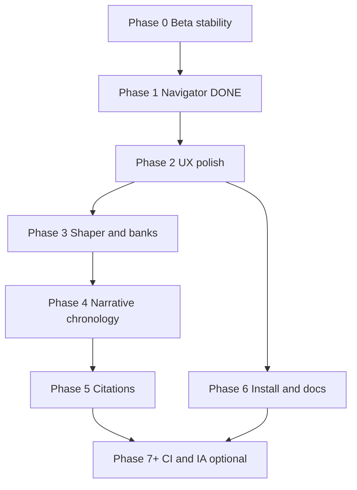

# ProzaEdit Word — Multi-Phase Implementation Plan

**Audience:** D Cracius (author, primary tester, PC + iPad workflows)  
**Authored:** 2026-10-31  
**Production baseline:** hosted build **2.0.0.14** ([source-of-truth](/cursor/stores/self/docs/source-of-truth.md))  
**North star:** [Next-Gen Master Specification](/cursor/stores/self/docs/prozaedit-nextgen-master-specification.md) (vNext architecture, post-2.0.0.14)  
**As-built acceptance:** [Feature Reference](/cursor/stores/self/docs/prozaedit-features.md)  
**Gap analysis:** [Spec Review](/cursor/stores/self/docs/prozaedit-nextgen-spec-review.md)  
**Code map:** [Codebase Overview](/cursor/stores/self/docs/prozaedit-codebase-overview.md)

---

## 1. Executive summary

**Where we are:** ProzaEdit Word is a **hosted beta** Office add-in (GitHub Pages + one-time `manifest.hosted.xml` upload). Core product is **local-first** audit, coach, and rewrite with optional Gemini. Shipped version **2.0.0.14** with manifest and `PROZAEDIT_BUILD_VERSION` aligned. Project documentation (source of truth, features, codebase overview, vNext spec + review) lives in the Project store; **Phase 1 code extraction** (`word-safe-navigator.js`) is on GitHub `main` (commit `91ecf56`).

**North star:** The vNext spec describes **Editorial Studio** UX, modular engines (chronology, citations, lexical shaper, tooltips, quota-aware Gemini), and additive tabs (**Narrative**, **Citations**) without replacing the v2 workflow strip or dropping **Checks**, **Thesaurus**, or batch/heatmap tooling.

**Principles (non-negotiable):**

1. **Audit surgically** — reproduce or understand failure modes; smallest fix; re-check manifest URLs, version strings, and Office load paths ([source-of-truth](/cursor/stores/self/docs/source-of-truth.md)).
2. **No regressions** — every phase ends with the [features doc](/cursor/stores/self/docs/prozaedit-features.md) smoke checklist on **Word on the web** (primary) and desktop where available.
3. **Incremental delivery** — no §11 HTML cutover; evolve `taskpane.html` / `taskpane.css` / `lib/*` in place.
4. **Version discipline** — bump `manifest.hosted.xml` `<Version>` and `PROZAEDIT_BUILD_VERSION` **together** only when users must re-upload; UI-only pushes need Pages refresh only.

---

## 2. Current state snapshot

### 2.1 Shipped capabilities (2.0.0.14)

Seven tabs + workflow strip: **Target**, **Thesaurus**, **Checks**, **Audit**, **Coach**, **Rewrite**, **Help**. Local audit engine (`audit-engine.js` + 16 sibling libs), document-scoped settings, continuity guard, section/chapter loop, heatmap, custom house style, report depth, Gemini optional paths. See [prozaedit-features.md](/cursor/stores/self/docs/prozaedit-features.md).

### 2.2 GitHub `main` — recent commits (newest first)

| Commit | Summary |
|--------|---------|
| `91ecf56` | **Phase 1:** Extract `word-safe-navigator.js`; wire HTML + `taskpane.js`; **no manifest bump** |
| `01304c2` | Master spec P0/P1 baseline (2.0.0.14, as-built IA, §11 disclaimer) |
| `5db8180` | Comprehensive feature reference doc (repo `docs/prozaedit-features.md`) |
| `98cbd68` | Sync `PROZAEDIT_BUILD_VERSION` with manifest **2.0.0.14** |
| `909101e` | Audit export to Word doc / txt / PDF guide |
| `d994916` | Report depth, check-for-updates, apply-fix hardening |
| `264638c` | Scope modes, char preview, continuity guard |

### 2.3 `src/taskpane/` inventory (after `91ecf56`)

| Path | Role |
|------|------|
| `taskpane.html`, `taskpane.css`, `taskpane.js` | Shell, styles, orchestration (~2.5k lines JS) |
| `lib/*.js` (**18 modules**) | Includes **`word-safe-navigator.js`** (sanitize, scope search, Go to) plus audit, scope, coach, rewrite, analytics, etc. |

**Still absent vs vNext spec:** `tooltip-registry.js`, `chronology-engine.js`, `lexical-shaper.js`, `lexical-banks.js`, `citation-engine.js`, `report-docx-export.js`, `ai-quota-manager.js`.

### 2.4 Known gaps (product + repo)

| Gap | Impact | Tracked |
|-----|--------|---------|
| Root `.bat` / `Create-Hosted-Manifest.bat`, `scripts/install/` | PC authors expect one-click install; only archive READMEs exist | Phases 0, 5 |
| **PE-2** Shared Folder catalog (Windows desktop) | Advanced sideload without web upload; scripts not on GitHub | Phase 5 |
| Help links to `docs/WORKFLOWS.md`, `docs/THIRD-PARTY-ATTRIBUTION.md` | Broken in-pane references | Phase 5 |
| No automated tests / CI | Manual Word verification only | Phase 6+ (optional) |
| vNext engines (timeline, citations, Zipf shaper) | Vision only until phased | Phases 3–4 |

### 2.5 Completed project work

| Item | Status |
|------|--------|
| Version sync (manifest + UI constant) | **Done** (PE-3, `98cbd68`) |
| Source of truth + audit discipline | **Done** (PE-4) |
| Features + codebase overview docs | **Done** (PE-1, PE-5) |
| vNext master spec + review; P0/P1 spec edits | **Done** (PE-6–PE-8) |
| **Phase 1:** `word-safe-navigator.js` extract | **Done** (PE-9, `91ecf56`) |
| Optional Phase 1 tail: `report-docx-export.js` extract | **Not started** (low priority) |

---

## 3. Phase overview

Phases **2–5** follow [spec review §5](/cursor/stores/self/docs/prozaedit-nextgen-spec-review.md#5-recommended-phasing-roadmap-surgical-no-regression), expanded with beta track, install restoration, and docs hygiene.

---

## Phase 0 — Beta stability track (ongoing)

**Goals:** Keep daily writing and tester onboarding reliable while vNext work lands incrementally.

**Scope:**

- Confirm **Home → ProzaEdit** after hosted manifest upload (Word web + same-account desktop).
- Remove legacy **localhost** sideload entries before hosted manifest.
- Distribute [raw manifest](https://github.com/drcracius/prozaedit-word/raw/main/manifest.hosted.xml) + repo `docs/BETA-TESTERS-INSTALL.txt`.
- After each GitHub push to `src/` or `assets/`: wait 1–3 min for Pages; hard-refresh task pane.
- **PE-2:** Shared Folder path — defer implementation to Phase 5; log blockers (Office cache, catalog path) when testing.

**Deliverables:**

- Author checklist completed (Step 6 in `docs/WHEN-YOU-RETURN.md`).
- Tester one-pager unchanged or updated only when install steps change.
- Short “known issues” note in Project store if regressions found (not in repo unless user-facing).

**Acceptance criteria:**

- Audit → Apply fix → Undo → Go to on a real chapter excerpt (web).
- **Check for updates** matches manifest semver or explains cache delay.
- No mismatch between UI build label and `manifest.hosted.xml` on `main`.

**Risks / mitigations:**

| Risk | Mitigation |
|------|------------|
| GitHub Pages cache stale | Document close/reopen pane; compare raw manifest vs UI label |
| Desktop lacks Upload | Default path: Word on the web once per account |
| Global mutes not synced across devices | Document in Help (browser profile); no code change in Phase 0 |

**Manifest / version:** No bump for stability-only verification. Bump only when Office registration must change (see per-phase policy below).

**Test plan:**

| Environment | Tests |
|-------------|--------|
| **Word on the web** (primary) | Full smoke: all tabs, fiction gating, extended audit, export |
| **Word desktop** (PC) | Same smoke if add-in visible; note Upload/catalog limitations |
| **iPad web** | Target + Audit read-only paths; document if Apply/undo differs |

**Depends on:** None (parallel to all phases).

---

## Phase 1 — Foundation extract & documentation truth ✅ COMPLETE

**Status:** **Complete** (PE-9, GitHub `91ecf56`).

**Goals:** Align spec with 2.0.0.14; extract Word search/navigation without behavior change.

**Scope (done):**

- Master spec P0/P1: production baseline, as-built IA, vNext mapping, §11 mockup disclaimer (`01304c2`).
- `ProzaEdit.WordSafeNavigator`: `sanitizeSearch`, `searchInScope`, `selectFirstInBody`; wired from `taskpane.js` + script tag in `taskpane.html`.

**Deliverables:** `src/taskpane/lib/word-safe-navigator.js`; reduced duplication in `taskpane.js`.

**Acceptance criteria (verified at merge):**

- 255-char cap and wildcard stripping unchanged.
- Apply fix, Go to, selection-only vs document paths identical to pre-extract behavior.
- **No** manifest bump (UI loads new module via Pages only).

**Optional follow-up (carry to Phase 2 or 3):**

- Extract **`report-docx-export.js`** from inline export logic (spec §8 shape; keep `.txt` fallback).

**Depends on:** Phase 0 discipline.

---

## Phase 2 — vNext UX polish (v2 IA retained)

**Goals:** Editorial Studio **incremental** visual and guidance upgrades without tab renames or §11 replacement.

**Scope:**

1. **`tooltip-registry.js`** — Central dictionary + `initTooltips(enabled)` per [master spec §3](/cursor/stores/self/docs/prozaedit-nextgen-master-specification.md); Target toggle **“Show hover tips”** (default on or off — see decision log); migrate Run audit, scope controls, Checks toggles, Apply/Mute from native `title` to `data-pe-tip`.
2. **CSS tokens** — Primary indigo, card surfaces, focus rings in `taskpane.css`; **keep** wordmark header and 4-step workflow strip.
3. **Optional:** `report-docx-export.js` extract if not done earlier.
4. **No** Checks→Audit merge in this phase.

**Deliverables:**

- New `lib/tooltip-registry.js`, styles for `.pe-tooltip-bubble`.
- Settings key in `settings-store.js` for tooltip preference (document or config blob — match existing Target autosave pattern).
- Updated help one-liner describing hover tips.

**Acceptance criteria:**

- [Features doc](/cursor/stores/self/docs/prozaedit-features.md) §2–§3 behaviors unchanged (Simple mode hides Gemini/Thesaurus; fiction `adaptModules()` unchanged).
- Tooltips off → no custom bubbles; keyboard focus does not trap.
- Visual diff limited to colors/spacing; no tab order change.

**Risks / mitigations:**

| Risk | Mitigation |
|------|------------|
| Tooltip overflow on narrow pane | Max-width + viewport clamp (spec CSS pattern) |
| Duplicate native `title` | Registry removes `title` when enabled only |
| Accessibility | `role="tooltip"`, associate via `aria-describedby` on first migrated controls |

**Manifest / version:** **UI-only** → no manifest bump; bump `PROZAEDIT_BUILD_VERSION` **optional** (only if Help/copy references new build label — prefer **no** bump until Phase 3 user-visible feature).

**Test plan:**

- Web: toggle tooltips; Run audit + batch section cancel; Dark/light browser chrome (no dark mode product requirement yet).
- Desktop PC: ribbon open task pane, verify tooltip positioning in WebView2.

**Depends on:** Phase 1 (navigator stable for any Go-to tooltip copy).

**Effort:** **M**

---

## Phase 3 — Lexical shaper evolution & shared banks

**Goals:** Introduce vNext **Shaper** as an **additive** panel on the **Rewrite** tab; extract shared word lists for maintainability.

**Scope:**

1. **`lexical-banks.js`** — Pleonasms, anti-AI phrases, wordiness lists currently duplicated across `audit-engine.js`, `local-rewrite.js`, `editor-heuristics.js`; refactor to single source with **no rule behavior change** in first PR.
2. **`lexical-shaper.js` v1** — Three sliders (Complexity / Intensity / Density) driving **existing** `local-rewrite.js` pipelines (weighted mode blend), **not** full Zipf engine yet.
3. UI: “Advanced shaper” disclosure on Rewrite; hidden in **Simple mode** (`pe-simple-mode` / `data-simple-hide`).
4. Wire preview/apply through existing selection limits (~3,500 chars) and selection-only toggle.

**Deliverables:**

- `lib/lexical-banks.js`, `lib/lexical-shaper.js`.
- Rewrite tab UI: sliders + preview block; coach copy optional.
- Unit-testable pure functions in banks/shaper (feeds Phase 6 CI if added).

**Acceptance criteria:**

- Four legacy modes (Fluency, Formal, Creative, Academic) still work unchanged when shaper panel collapsed.
- Audit card counts and scoring unchanged when shaper unused.
- Gemini rewrite path untouched unless explicitly extended later.

**Risks / mitigations:**

| Risk | Mitigation |
|------|------------|
| Refactor changes audit findings | Banks extract in dedicated commit; diff audit output on fixed fixture manuscript snippet |
| Shaper overwrites voice | Preview-only default; confirm before apply (reuse existing confirm toggle) |

**Manifest / version:** **Optional patch** manifest bump (e.g. 2.0.0.15) if beta testers should see “Rewrite / Shaper” in release notes; otherwise UI-only push.

**Test plan:**

- Web: each slider extreme + middle; Apply + ProzaEdit undo.
- PC: long selection boundary (3,501 chars rejected).

**Depends on:** Phase 2 (tooltips for sliders); Phase 1 navigator for any future shaper→Go to.

**Effort:** **L** (banks refactor) + **M** (shaper v1 UI)

---

## Phase 4 — Narrative & chronology engine (additive)

**Goals:** Fiction-grade **timeline visibility** and richer continuity findings without replacing existing `mContinuity` / `mSpoiler` heuristics.

**Scope:**

1. **`chronology-engine.js` v1** — Paragraph-index walk on scoped text; extract temporal anchors (regex + phrase list); ordered event list with `paraIndex`; findings merged into standard audit card pipeline (rule IDs, mute, density caps via `report-density.js`).
2. **UI:** **Additive** — prefer **Checks sub-panel** “Timeline scan” or new **Narrative** tab (decision log); scan button; list UI with **Go to** via `WordSafeNavigator`.
3. **Spoiler guard v1** — Cross-check reveals vs selected chapter scope (heuristic; heavy false-positive risk — gate behind fiction type + opt-in toggle).
4. **Export:** When `report-docx-export.js` exists, optional chronology section in Word report.

**Deliverables:**

- `lib/chronology-engine.js`.
- UI surface + settings keys (depth: chapter vs scene).
- Documentation section in features doc (beta honesty: heuristics not continuity bible).

**Acceptance criteria:**

- Default Checks/Audit unchanged when chronology toggle off.
- Performance: respect existing caps (150k–450k scope, 15k paragraph stats cap); show truncation card when exceeded.
- All navigation uses `WordSafeNavigator.sanitizeSearch`.

**Risks / mitigations:**

| Risk | Mitigation |
|------|------------|
| Extra `Word.run` batches slow full manuscript | Run chronology only on explicit scan; cache snapshot in document settings (like heatmap) |
| False anachronisms in dialogue | Card type `preference`; module filter; Mute/Dismiss |
| IA clutter | Start as Checks sub-panel; promote to tab after D sign-off |

**Manifest / version:** Bump when new tab changes ribbon description or support docs — otherwise UI-only.

**Test plan:**

- Web: fiction manuscript sample; partial vs full scope; Go to from timeline row.
- PC: same; compare heatmap + chronology both stored in settings.

**Depends on:** Phase 1 navigator; Phase 3 banks optional (shared temporal phrase list).

**Effort:** **L**

---

## Phase 5 — Citations engine (opt-in, academic/legal)

**Goals:** Move beyond academic **citation hint** card toward stylebook-flavored pattern checks, still local-first.

**Scope:**

1. **`citation-engine.js` v1** — Regex/heuristic packs for **APA-ish**, **CMOS-ish**, **Bluebook-lite** (explicitly not compliance certification); in-text patterns, missing year, broken `Id.`/`Ibid.` chains where detectable.
2. **Activation:** Manuscript types Academic, Business, Technical/Journalism toggles; **no standalone Citations tab** until v1 accuracy validated on D’s real briefs (sub-panel on Checks or Audit filter “Citations”).
3. Findings → standard cards; integrate with custom house rules where overlaps exist.

**Deliverables:**

- `lib/citation-engine.js`.
- Target/Checks opt-in toggle; help text on limitations.
- Optional bibliography scan (paragraph at end of doc) — **v1.1** if v1 too noisy.

**Acceptance criteria:**

- Fiction manuscripts: zero citation scans unless override on.
- Card density respects report depth settings.
- No network calls.

**Risks / mitigations:**

| Risk | Mitigation |
|------|------------|
| Legal liability from “Bluebook validated” | Copy: “pattern assist only”; cite public style summaries |
| Regex explosion on footnotes | Scope to body text first; footnote API later |

**Manifest / version:** Bump if new manifest `<Description>` needed; else UI-only.

**Test plan:**

- Web: sample academic doc with intentional errors; mute/dismiss flow.
- PC: same.

**Depends on:** Phase 4 optional (no hard dependency); Phase 2 tooltips recommended.

**Effort:** **L** (v1), **XL** (full spec §7 + tab)

---

## Phase 6 — Install/catalog restoration & docs/help hygiene

**Goals:** Restore trustworthy PC install story and fix broken help pointers.

**Scope:**

1. **Install artifacts on GitHub `main`:**
   - Minimal **PowerShell** `Create-Hosted-Manifest.ps1` (or documented equivalent) aligning URLs with [source-of-truth](/cursor/stores/self/docs/source-of-truth.md).
   - **`scripts/install/`** or `install/` folder: `Install-WordAddin.ps1`, `Register-TrustedCatalog.ps1`, wrapped by **`Install-In-Word.bat`** — recovered from restore point / `_archive/local-dev` per codebase overview; README with cache-clear steps.
2. **PE-2 validation:** Shared Folder catalog on Windows after Office cache clear; document success/failure in repo `docs/BETA-SETUP-GITHUB.md` or `docs/WINDOWS-SHARED-FOLDER-INSTALL.md`.
3. **Missing docs:** Add `docs/WORKFLOWS.md`, `docs/THIRD-PARTY-ATTRIBUTION.md` (and `STYLE-GUIDE-SOURCES.md` if still referenced) — content aligned with in-pane help, no false claims.
4. **Repo `docs/prozaedit-features.md`:** Keep in sync with Project store copy or single-source policy (decision log).

**Deliverables:**

- Scripts + verified README paths.
- New/updated repo docs; taskpane.html links use **GitHub raw or Pages URLs** where possible (Office WebView may not read local `docs\` paths).

**Acceptance criteria:**

- Fresh Windows PC: documented path completes install **or** clearly states “web upload only” with PE-2 result recorded.
- No 404 references from Help tab copy.
- Scripts run with execution policy called out; no secrets in repo.

**Risks / mitigations:**

| Risk | Mitigation |
|------|------------|
| Antivirus flags `.bat` | PowerShell-first; code-sign note in README |
| Catalog path differs by Office build | Document version matrix; PE-2 explicit |

**Manifest / version:** Bump if script generates manifest users must re-upload; script output must match hosted manifest semver.

**Test plan:**

- **PC-only:** Shared Folder, bat/ps1, desktop Word catalog.
- **Web/iPad:** Help links open readable docs in browser.

**Depends on:** Phase 0 beta process; can parallel Phases 2–5 (docs fixes can start early).

**Effort:** **M** (docs only) to **L** (full PE-2 + scripts)

---

## Phase 7+ — Optional hardening & vNext completion

**Goals:** Long-horizon items from [spec review P2–P3](/cursor/stores/self/docs/prozaedit-nextgen-spec-review.md#p2--defer-or-narrow-scope-implement-after-baseline-doc-fix) without blocking beta.

**Scope (pick incrementally):**

| Workstream | Contents | Effort |
|------------|----------|--------|
| **7a — AI quota** | `ai-quota-manager.js`; session/monthly ceilings; default **off** | M |
| **7b — CI** | Minimal `package.json` + lint + pure-function tests (banks, shaper, chronology, citation); no Office.js in CI | M |
| **7c — Report module** | Finish `report-docx-export.js`; chronology + citation sections | S–M |
| **7d — Zipf shaper v2** | True complexity axis per spec §5 | L |
| **7e — IA consolidation** | Merge Checks into Audit **only if** user testing + parity checklist pass; never drop Thesaurus without Simple-mode path | M (UX) + risk |
| **7f — Dark mode** | Full Editorial Studio tokens | L |
| **7g — Header metrics** | Global scope pill + token pill | M |

**Acceptance criteria:** Per sub-project; each must pass full Phase 0 smoke plus new feature toggles default-off.

**Manifest / version:** Per sub-project; quota/settings modal might warrant minor bump.

**Depends on:** Phases 1–6 as appropriate.

---

## 4. Parallel workstreams (D vs agent/dev PC)

| Work | **D (iPad / Project / browser)** | **PC-only (Word desktop, PowerShell, sideload)** |
|------|-----------------------------------|--------------------------------------------------|
| Phase 0 smoke | Word on the web; real manuscript editing | Desktop Word same account; remove localhost add-in |
| Phase 2 UX review | Visual/tooltip pass on web | WebView2 tooltip positioning |
| Phase 3 shaper | Rewrite preview on selection | Same |
| Phase 4 chronology | Fiction sample on web | Full-manuscript scan perf |
| Phase 5 citations | Paste academic sample in web Word | Footnote-heavy doc if available |
| **Phase 6 install** | Read/help verify links on iPad Safari | **PE-2 Shared Folder**, `.bat`, catalog, cache clear |
| Phase 7 CI | Review PR checks on GitHub | Run local test script before push |
| Project store docs | Notes, plan, preferences | N/A |
| GitHub code | Merge PRs via web | Clone push if needed |

**Rule:** Any change touching `Word.run` batching or desktop catalog **must** be validated on PC before manifest bump.

---

## 5. Decision log & open questions (for D)

| ID | Question | Options | Recommendation | Phase impacted |
|----|----------|---------|----------------|----------------|
| D1 | Merge **Checks** into **Audit**? | A) Keep separate (v2) B) Merge after parity C) Merge + workflow strip update | **A until 7e**; spec review warns of regression | 2, 7e |
| D2 | When to bump **manifest** semver? | UI-only vs re-upload required | Follow [source-of-truth](/cursor/stores/self/docs/source-of-truth.md): manifest bump only for Office registration change; use build label for Help anyway | All |
| D3 | Chronology UI: sub-panel vs **Narrative** tab? | Checks panel vs new tab | **Checks sub-panel first** (lower IA risk) | 4 |
| D4 | Tooltips default on? | on / off | **On** for beta discoverability; Target toggle | 2 |
| D5 | Shaper: rename tab to “Shaper” or keep **Rewrite**? | Rename vs subtitle | Keep **Rewrite** label; subtitle “Lexical shaper” until D prefers rename | 3 |
| D6 | Citations: when to add dedicated tab? | After v1 accuracy / never | **After** real brief validation | 5 |
| D7 | Restore full npm dev server on `main`? | `_archive` only vs `dev/` folder | Slim **`dev/`** optional; hosted beta remains default | 6, 7b |
| D8 | Single source for features doc? | Repo only vs Project store mirror | Repo for testers; Project store for agents — sync on release | 6 |
| D9 | Optional README pointer to this plan? | Repo `docs/` one-liner | Coordinator choice — not required for plan validity | — |

---

## 6. Milestone table

| Milestone | Phase | Outcome | Effort | Manifest bump? |
|-----------|-------|---------|--------|------------------|
| M0 | 0 | Author + tester path verified | S | No |
| M1 | 1 ✅ | `word-safe-navigator.js` on `main` | S | No |
| M2 | 2 | Tooltips + CSS tokens | M | Unlikely |
| M3 | 3 | Banks extract + shaper v1 panel | L | Optional |
| M4 | 4 | Chronology scan + Go to | L | Optional |
| M5 | 5 | Citation heuristics opt-in | L | Optional |
| M6 | 6 | PE-2 result + docs + install scripts | M–L | If script changes manifest |
| M7a | 7 | AI quota (off by default) | M | Maybe |
| M7b | 7 | CI smoke for pure JS | M | No |

**Effort key:** **S** = focused session; **M** = multi-day surgical work; **L** = engine + UI + manual Word validation; **XL** = full spec module (citations tab, Zipf).

---

## 7. Cross-phase test matrix (Word)

| Capability | Web (required) | Desktop PC | iPad web |
|------------|----------------|------------|----------|
| Run audit / extended | ✓ | ✓ | ✓ |
| Apply fix / undo | ✓ | ✓ | ✓ |
| Section/chapter loop | ✓ | ✓ | Limited UI |
| Heatmap build | ✓ | ✓ | ✓ |
| Gemini paths | ✓ | ✓ | ✓ (if key) |
| Shared Folder install | — | ✓ PE-2 | — |
| Tooltip/shaper/chronology | ✓ | ✓ | ✓ read/scan |

After **every merge to `main` affecting `src/`:** run **minimum smoke**: Target save → Checks Run audit → Audit Apply one safe fix → Undo → Help Check for updates.

---

## 8. Version & release policy (summary)

| Change type | `manifest.hosted.xml` | `PROZAEDIT_BUILD_VERSION` | User action |
|-------------|----------------------|----------------------------|-------------|
| Copy/CSS/tooltips | No bump | Optional (prefer sync only on manifest bumps) | Refresh pane |
| New module load (JS) | No bump unless Office requires | Match manifest when bumped | Refresh pane |
| Ribbon/description/version visibility | Bump patch (e.g. .15) | **Must match** | Re-upload manifest |
| Add-in ID or URL change | Bump + review | **Must match** | Re-upload manifest |

---

## 9. Related documents

| Document | Path |
|----------|------|
| Source of truth | [/cursor/stores/self/docs/source-of-truth.md](/cursor/stores/self/docs/source-of-truth.md) |
| Features (2.0.0.14) | [/cursor/stores/self/docs/prozaedit-features.md](/cursor/stores/self/docs/prozaedit-features.md) |
| Codebase overview | [/cursor/stores/self/docs/prozaedit-codebase-overview.md](/cursor/stores/self/docs/prozaedit-codebase-overview.md) |
| vNext master spec | [/cursor/stores/self/docs/prozaedit-nextgen-master-specification.md](/cursor/stores/self/docs/prozaedit-nextgen-master-specification.md) |
| Spec review & §5 phasing | [/cursor/stores/self/docs/prozaedit-nextgen-spec-review.md](/cursor/stores/self/docs/prozaedit-nextgen-spec-review.md) |
| Project tasks | [notes.md](/cursor/stores/self/notes.md) (PE-2, PE-10) |

---

*Plan aligned to GitHub `main` through `91ecf56` (18 `lib/` modules including `word-safe-navigator.js`). Update this file when phases complete or when manifest baseline advances beyond 2.0.0.14.*
